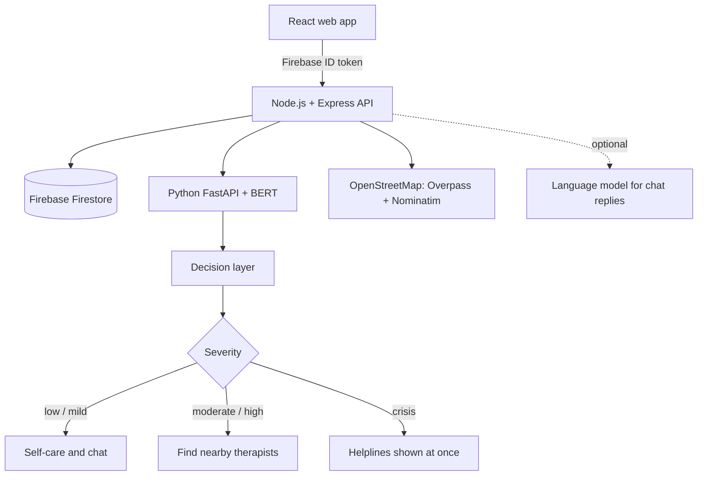

# MindEase

**AI-powered mental wellness web app.** Chat or speak to an AI companion, get BERT-based mood analysis and a therapist-need screening (PHQ-2 / GAD-2), and find nearby therapists and hospitals on a Leaflet map.


> **Important:** MindEase is a screening and support tool. It does **not** diagnose any condition and is **not** a replacement for professional care or an emergency service. If you or someone else is in danger, call your local emergency number.

<!-- Replace with your own link after uploading the video (GitHub Releases or YouTube) -->
**Demo video:** _add link here_

---

## Table of contents

- [Features](#features)
- [Screenshots](#screenshots)
- [How it works](#how-it-works)
- [Tech stack](#tech-stack)
- [Project structure](#project-structure)
- [Getting started](#getting-started)
- [Configuration](#configuration)
- [API overview](#api-overview)
- [Data and privacy](#data-and-privacy)
- [Training your own model](#training-your-own-model)
- [Known limitations](#known-limitations)
- [Troubleshooting](#troubleshooting)
- [Roadmap](#roadmap)
- [Contributing](#contributing)
- [License](#license)

---

## Features

Each module is its own page.

| Page | Route | What it does |
|---|---|---|
| Home | `/` | Overview of every module |
| AI Chatbot | `/chatbot` | Chat about your feelings. Each message is read by BERT and shown as a mood chip. Every third message the whole conversation is assessed, and a banner suggests a therapist if needed. Conversations can be reopened, exported or deleted. |
| AI Therapist | `/therapist` | The same chat plus guided tools (breathing, grounding, thought check, safe place, affirmation, journaling), a saved mood check-in, a session timer and spoken replies |
| Voice Assistant | `/voice` | Real browser speech recognition and speech synthesis through the same chat service |
| Mind Check | `/mind-check` | Write how you feel, optionally add PHQ-2 and GAD-2 questions, and see whether a therapist is advised, with reasons and an emotion breakdown |
| Nearby Therapist | `/nearby` | Leaflet map of psychiatrists, psychologists, counsellors and hospitals from OpenStreetMap, with location or address search, radius, filters and directions |
| Emergency Help | `/emergency` | Helplines by region, breathing exercise and 5-4-3-2-1 grounding |
| My History | `/history` | Past readings, mood check-ins and conversations, plus one-click deletion of all your data |

Other highlights:

- Email/password and Google sign-in with Firebase Authentication
- Optional LLM-powered chat replies, with a built-in empathetic rule engine as the default and the fallback
- Automatic crisis response: messages about self-harm get a fixed safety reply with helplines, even if the AI service is down
- Responsive layout, keyboard navigation, readable contrast and reduced-motion support

## Screenshots

> Copy your screenshots into `docs/screenshots/` using the file names below.

| | |
|---|---|
|  |  |
|  |  |
|  |  |
|  |  |
|  |  |

## How it works



1. The user writes or speaks a message, or submits a Mind Check.
2. The Node API verifies the Firebase token and sends the text to the Python service.
3. BERT returns a probability for each emotion.
4. The decision layer turns those into a **distress score**, combines it with PHQ-2/GAD-2 answers and a self-harm phrase check, and returns a severity (`low`, `mild`, `moderate`, `high`, `crisis`) and `needs_therapist`.
5. The app shows the result and, if help is advised, links to the nearby therapist map.

### The decision layer

```
distress = Σ P(emotion) × weight(emotion)
weights: sadness 1.0 · fear 0.8 · anger 0.55 · surprise 0.15 · joy 0 · love 0
```

| Condition | Severity |
|---|---|
| Self-harm phrase found | `crisis` |
| Score ≥ 0.85, or positive questionnaire with score ≥ 0.6, or a questionnaire total of 5 or 6 | `high` |
| Score ≥ 0.6, or PHQ-2 or GAD-2 total ≥ 3 | `moderate` |
| Score 0.35 to 0.6 | `mild` |
| Otherwise | `low` |

A therapist is advised for `moderate`, `high` and `crisis`. Very short text (under 8 words) cannot reach `high` on its own.

> The weights and thresholds are **heuristics**, not clinically validated cut-offs. Tune them on labelled data and have a mental-health professional review them before any real-world use. See `ml/decision.py`.

## Tech stack

| Layer | Technologies |
|---|---|
| Front end | React 18, Vite, React Router, Leaflet, Lucide icons, Firebase client SDK, Web Speech API |
| Back end | Node.js (ES modules), Express, firebase-admin, helmet, cors, express-rate-limit |
| AI service | Python, FastAPI, Uvicorn, PyTorch, Hugging Face Transformers (BERT) |
| Database and auth | Firebase Authentication, Cloud Firestore |
| Maps and places | Leaflet, OpenStreetMap tiles, Overpass API, Nominatim |

The default model is [`bhadresh-savani/bert-base-uncased-emotion`](https://huggingface.co/bhadresh-savani/bert-base-uncased-emotion), a BERT model fine-tuned on six emotions.

## Project structure

```
mindease/
├── client/                 React app (Vite)
│   └── src/
│       ├── pages/          Home, Login, Chatbot, Therapist, Voice, MindCheck, Nearby, Emergency, History
│       ├── components/     Layout, ChatPanel, AssessmentCard, BreathingOverlay
│       ├── hooks/          useChat, useSpeech
│       ├── context/        AuthContext, MoodContext
│       └── data/           helplines, tools, emotion labels
├── server/                 Node.js + Express API
│   └── src/
│       ├── routes/         chat, analyze, places, me
│       ├── services/       ml, chat, rules, safety, places
│       └── middleware/     auth
├── ml/                     Python BERT service
│   ├── app.py              FastAPI app
│   ├── decision.py         distress score and therapist decision
│   └── train.py            optional fine-tuning script
├── firestore.rules         denies all direct browser access
├── firebase.json
└── package.json            root scripts
```

## Getting started

### Prerequisites

- Node.js 18 or newer
- Python 3.10 to 3.12 (3.13 and newer may lack installers for PyTorch)
- A Firebase project
- About 5 GB of free disk space and 8 GB of RAM

### 1. Clone

```bash
git clone https://github.com/<your-username>/mindease-ai-wellness.git
cd mindease-ai-wellness
```

### 2. Set up Firebase

1. Create a project at [console.firebase.google.com](https://console.firebase.google.com).
2. **Authentication**: enable the **Email/Password** and **Google** sign-in methods.
3. **Firestore Database**: create a database.
4. **Project settings, General, Your apps**: register a **Web** app and copy its config values.
5. **Project settings, Service accounts**: generate a new private key and save it as `server/serviceAccountKey.json`. **Never commit this file.**
6. Deploy the Firestore rules (they block all direct browser access, since the server uses the Admin SDK):
   ```bash
   npx firebase-tools deploy --only firestore:rules
   ```
7. Under **Authentication, Settings, Authorized domains**, make sure `localhost` is listed (and your site's domain when you deploy).

### 3. Configure environment files

```bash
# macOS / Linux / Git Bash
cp server/.env.example server/.env
cp client/.env.example client/.env
```
```powershell
# Windows PowerShell
copy server\.env.example server\.env
copy client\.env.example client\.env
```

Fill them in using the [configuration table](#configuration).

### 4. Start the BERT service (terminal 1)

```bash
cd ml
python -m venv .venv
```
```powershell
.venv\Scripts\Activate.ps1      # Windows PowerShell
```
```bash
source .venv/bin/activate        # macOS / Linux
```
```bash
pip install -r requirements.txt
python -m uvicorn app:app --port 8000
```

The first start downloads the model (about 440 MB). Wait for `Application startup complete`.

> On Windows, if PowerShell blocks the activate script, run `Set-ExecutionPolicy -Scope CurrentUser RemoteSigned` once.

### 5. Start the API and web app (terminal 2)

From the project root:

```bash
npm run install:all
npm run dev
```

| Service | URL |
|---|---|
| Web app | http://localhost:5173 |
| Node API | http://localhost:5000 |
| BERT service | http://localhost:8000 |

Open **http://localhost:5173** in Chrome or Edge (voice features need one of them), create an account, and start with the AI Chatbot or Mind Check.

### Production build

```bash
npm run build     # builds the React app
npm start         # Express serves the API and the built app on port 5000
```

Production needs HTTPS, because browsers only allow the microphone and location on secure pages.

## Configuration

### `server/.env`

| Variable | Required | Description |
|---|---|---|
| `PORT` | No | API port (default `5000`) |
| `CLIENT_ORIGIN` | No | Allowed web origin (default `http://localhost:5173`) |
| `ML_SERVICE_URL` | No | BERT service address (default `http://localhost:8000`) |
| `FIREBASE_SERVICE_ACCOUNT` | Yes | Path to the service account JSON (for example `./serviceAccountKey.json`) |
| `OSM_USER_AGENT` | Yes | Identifying text with a contact email, required by OpenStreetMap's usage policy |
| `ANTHROPIC_API_KEY` | No | Enables LLM chat replies. Without it, the rule engine answers. |
| `CLAUDE_MODEL` | No | Model name for LLM replies |

### `client/.env`

| Variable | Required | Description |
|---|---|---|
| `VITE_FIREBASE_API_KEY` | Yes | From the Firebase web app config |
| `VITE_FIREBASE_AUTH_DOMAIN` | Yes | From the Firebase web app config |
| `VITE_FIREBASE_PROJECT_ID` | Yes | From the Firebase web app config |
| `VITE_FIREBASE_APP_ID` | Yes | From the Firebase web app config |
| `VITE_API_URL` | No | Leave empty in development (Vite proxies `/api`) |

### ML service (optional environment variables)

| Variable | Description |
|---|---|
| `MODEL_NAME` | Hugging Face model to download (default `bhadresh-savani/bert-base-uncased-emotion`) |
| `MODEL_DIR` | Folder of a model you trained (default `ml/model`, used automatically if it exists) |

## API overview

All `/api` routes except `/api/health` require `Authorization: Bearer <Firebase ID token>`.

| Method and path | Purpose | Rate limit (per user per minute) |
|---|---|---|
| `GET /api/health` | Health check (public) | n/a |
| `POST /api/chat` | Send a message, get a reply and mood reading | 30 |
| `GET /api/chat/sessions` | List conversations (`?kind=chatbot`, `therapist` or `voice`) | 30 |
| `GET /api/chat/sessions/:id/messages` | Load a conversation | 30 |
| `DELETE /api/chat/sessions/:id` | Delete a conversation | 30 |
| `POST /api/analyze` | Mind Check: BERT result and therapist decision | 10 |
| `GET /api/places/search` | Nearby therapists and hospitals (`lat`, `lng`, `radius` 1 to 50 km) | 30 |
| `GET /api/places/geocode` | Address to coordinates | 30 |
| `POST /api/mood` | Save a mood check-in | 120 |
| `GET /api/dashboard` | History data | 120 |
| `DELETE /api/me/data` | Delete all of the user's data | 120 |

ML service: `POST /predict` with `{ "text": "...", "screening": { "phq2": 0-6, "gad2": 0-6 } }` and `GET /health`.

## Data and privacy

Data lives in Firestore, scoped to each user:

```
users/{uid}/sessions/{sessionId}            title, kind, counts, last message
users/{uid}/sessions/{sessionId}/messages   role, text, time, detected emotion
users/{uid}/assessments                     label, severity, needs_therapist, score (no raw text)
users/{uid}/moods                           mood, time
```

- Mind Check stores **only the result**, never the text you wrote. Chat messages are stored so conversations can be resumed.
- The browser never reads Firestore directly. The security rules deny all client access, and every request goes through the API after the token is verified.
- Users can delete a conversation, or all their data, from the app.
- Text from OpenStreetMap is treated as untrusted and rendered as plain text, never as HTML.
- Voice recognition uses your browser's speech service. In Chrome and Edge, audio may be sent to the browser vendor to turn it into text.

If you deploy this publicly, review the data protection and health-data laws that apply to your users (for example India's Digital Personal Data Protection Act, 2023, or GDPR), and add a privacy policy and consent screens.

## Training your own model

The default model detects general emotions, not mental-health conditions. For better screening, fine-tune BERT on a labelled dataset:

```bash
cd ml
python train.py --csv data.csv --text-col statement --label-col status
```

The model is saved to `ml/model/` and picked up automatically on the next start. Use class names such as `Normal`, `Anxiety`, `Depression`, `Stress`, `Suicidal` and `Bipolar` so they match the weights in `ml/decision.py`, and update `DISTRESS_WEIGHTS` for any new labels. Check each dataset's licence before using it, and report accuracy, precision, recall and F1 (especially recall on the serious classes) on a held-out test set.

## Known limitations

- The default model measures emotion, not clinical need, so sad but harmless text may raise the score and some real distress may be missed.
- Weights and thresholds are heuristic and not clinically validated.
- Crisis detection uses a fixed phrase list, so indirect statements can be missed.
- English only.
- Therapist results depend on OpenStreetMap coverage, which varies by area, and there is no appointment booking.
- Voice input works in Chrome and Edge only.
- Helpline numbers in `client/src/data/content.js` should be verified before any public use.
- The project has not been evaluated with real users or by clinicians.

## Troubleshooting

| Problem | Fix |
|---|---|
| "Firebase keys are missing" on the login page | Fill in `client/.env`, then restart `npm run dev` |
| "Server is not connected to Firebase" | Check that the file named in `FIREBASE_SERVICE_ACCOUNT` exists |
| "The BERT service is not reachable" | Start the Python service first and wait for the model to load. Chat still works without it, but without mood chips. |
| Google sign-in popup fails | Add your domain under Firebase, Authentication, Settings, Authorized domains |
| `localhost:3000` shows "connection refused" | The web app runs on port **5173**, not 3000 |
| `pip install` fails on `torch` | Use Python 3.10 to 3.12 (for example `py -3.12 -m venv .venv` on Windows) |
| Slow installs or file lock errors on Windows | Keep the project outside OneDrive-synced folders |
| No therapists found | Widen the radius or choose the "All" filter. OpenStreetMap coverage varies. |
| Microphone does not work | Use Chrome or Edge, and allow microphone access |

## Roadmap

- Fine-tune on a mental-health dataset and publish evaluation metrics
- Stronger crisis detection, reviewed by a professional
- Indian-language support
- Mood trend charts and optional reminders
- Automated tests and CI on every commit
- Smaller or faster model for deployment

## Contributing

Issues and pull requests are welcome. Please open an issue first to discuss large changes. Never commit secrets (`.env` files, service account keys), and if you touch the safety, crisis or privacy behaviour, describe the change clearly in your pull request.

## License

Add a licence of your choice (for example MIT) as a `LICENSE` file, and update this section.

## Acknowledgements

- [Hugging Face Transformers](https://huggingface.co/docs/transformers) and the `bhadresh-savani/bert-base-uncased-emotion` model
- [OpenStreetMap](https://www.openstreetmap.org) contributors, [Overpass API](https://wiki.openstreetmap.org/wiki/Overpass_API) and [Nominatim](https://nominatim.org)
- [Leaflet](https://leafletjs.com), [React](https://react.dev), [Firebase](https://firebase.google.com) and [FastAPI](https://fastapi.tiangolo.com)
- The PHQ-2 and GAD-2 screening questions (Kroenke, Spitzer and Williams)

---

If you are struggling, please reach out to someone you trust or a professional. In India, Tele-MANAS is available at **14416**. In the US, call or text **988**. Other countries: [findahelpline.com](https://findahelpline.com).
